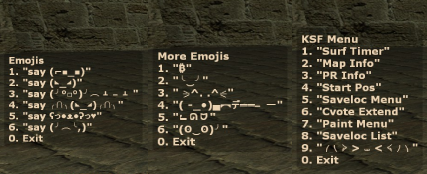

# Custom Radio Panels for Counter-Strike: Source

21 extra bind slots replacing useless radio commands.

## Install

1. Put `autoexec.cfg` in `cstrike\cfg\` (merge with your own if you already have one)
2. Copy `cstrike_english.txt` and put it in `\cstrike\custom\%CUSTOMHUD%\resource\`

## Info

Edit any command in autoexec as you wish, same with the in-game text.  
In game UI works off "RadioA" "RadioB" "RadioC" in cstrike_english.txt.  
Works with KSF Commands (sm_) or any console command ("say ╭∩╮(◣_◢)╭∩╮")  

Keep syntax & aliases the same otherwise it breaks ╮(ˆ𐃷ˆ)╭

## Other languages

Only English is included. For other languages, edit the matching file in `\cstrike\resource\` (e.g. `cstrike_russian.txt`)

## Known issues

- **Slot limit:** 6 / 6 / 9, No way around it. 
- **High ping + server menus:** Slim chance binds can execute instead of the menu selection
  (seen once in ~12 hours).

If it breaks ask claude or something ◡̈

Based on [Custom radiopanel for CS:S](https://steamcommunity.com/sharedfiles/filedetails/?id=3176537507) by Yum1ko.
